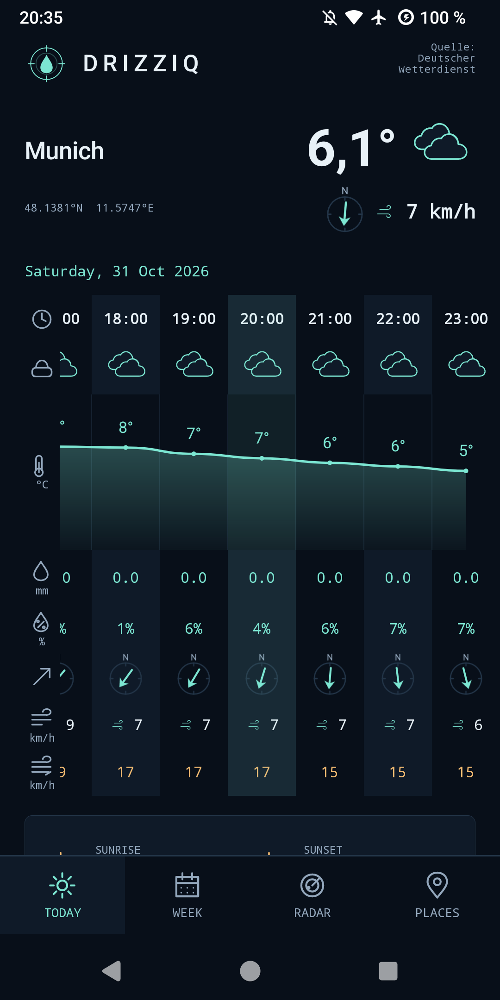

<h1 align="center">Drizziq</h1>

<p align="center">A dark atmospheric console for DWD weather forecasts and precipitation radar.</p>

<p align="center">
  <a href="https://codeberg.org/k4r/drizziq"></a>
  <a href="app/build.gradle.kts"></a>
  
  <a href="LICENSE"></a>
</p>

<p align="center">
  
</p>

Raw capture from the current debug build on a OnePlus 5T / Android 13. Weather data © Deutscher Wetterdienst, [CC BY 4.0](https://creativecommons.org/licenses/by/4.0/).

Drizziq is a native Kotlin Android app for one selected place. It reads weather directly from Deutscher Wetterdienst open data and runs on Android 7.0+ (API 24). No accounts, ads, analytics or tracking. Location permission is optional and used only for an explicit current-location request.

## What it does

- **Today.** A midnight-to-midnight timeline for the selected place’s local date, with narrower hour columns, bold time labels/icons, a temperature ribbon, precipitation amount/probability, wind, optional gusts and humidity. DST days retain their real 23/25 hours. Missing forecast hours remain unknown. A locally calculated sunrise/sunset card works offline, independently of DWD coverage.
- **Week.** A compact table for the coming seven days: condition, high/low, rain, maximum wind and sunshine. Daily rain/sunshine require complete local days. Today and Week share the same station details, air pressure, timezone and last-updated card.
- **Radar.** A full-width map with a subtle selected-place marker, drag/pinch/double-tap gestures and transparent playback/timeline controls over the map. Center and zoom survive restarts; accessibility zoom/recenter actions remain available. DWD RV supplies recent observations and available forecasts. Attribution stays visible.
- **Places.** Explicit city search using Open-Meteo or a one-shot Android location fix. Device snapshots display the resolved DWD station name. Save/select/delete labelled favourites; selection, full coordinates, zones and source attribution persist. Time zones resolve offline when needed, with a zone-only prompt if unresolved. Manual coordinate entry has been removed; existing saved places remain usable.
- **Header, navigation and downloads.** A taller header emphasizes current temperature, condition icon and wind to the right of a smaller, two-line location name with ellipsis for long names, shared across every view. Square Today, Week, Radar and Places tabs. A thin global progress line tracks weather, city-search and map-tile downloads in a reserved slot, so appearing/disappearing never moves the layout.
- **Honest data states.** Forecast freshness is explicit; radar shows loading, cached, stale and error notices when needed. Failed refreshes retain timestamped successful data. Missing DWD fields are omitted; relative humidity is normally absent from MOSMIX. Daily rain and sunshine totals require every hourly interval of a complete local day.

## Build and install

Requires JDK 21, Android SDK platform 37 and Build Tools 36.0.0. Open this directory in Android Studio, or set `ANDROID_HOME` to your SDK and run:

```sh
./tools/verify --gradle-only assembleDebug
adb install -r app/build/outputs/apk/debug/app-debug.apk
adb shell am start -n app.drizziq/.MainActivity
```

The wrapper pins Gradle 9.8.2 with a distribution checksum. Android Gradle Plugin 9.4.1 supplies Kotlin support. The only application library is jHDF 0.13.0, which reads DWD's current ODIM HDF5 radar format; Android core-library desugaring supports API 24.

Run the complete local development gate with:

```sh
./tools/verify
```

This checks Kotlin formatting, Python tooling tests, JVM unit tests, Android lint, and debug/release/device-test APK builds. No CI or phone is required. See [DEVELOPMENT.md](docs/DEVELOPMENT.md) for test-first development, focused checks, debug signing, and quick versus full phone verification. [AGENTS.md](AGENTS.md) defines the workflow for agents.

The default phone runner performs smoke checks. Use `--places-integration` for city selection and favourite persistence checks that restore the original places and map camera. Use `--full` explicitly for older integration checks that change test favourites and connectivity.

## Data

Weather comes exclusively from `https://opendata.dwd.de/weather/`. MOSMIX is a station forecast: the app chooses the nearest bundled point within 50 km and displays its distance; outside that radius it explains the coverage limit. DWD radar covers Germany and its surroundings; places outside that coverage receive an explicit coverage message. The keyless OpenStreetMap basemap has visible attribution and caches only tiles viewed on screen for at least seven days.

City search sends only explicit search text to the free, non-commercial Open-Meteo geocoding service, with GeoNames attribution. Device positions resolve to forecast points locally, without reverse geocoding. All app icon sources are editable SVGs in [artwork/icons](artwork/icons/README.md), compiled automatically to native Android vectors. [DATA.md](docs/DATA.md) records data sources, processing, licences and metadata regeneration.

## License

[MIT](LICENSE). DWD data, OpenStreetMap data, timezone data and dependencies retain their [respective licences](docs/DATA.md).
