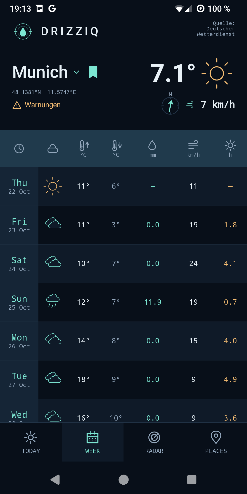
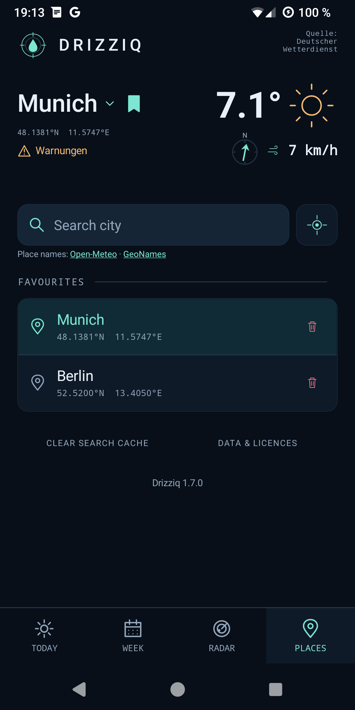

<h1 align="center">Drizziq</h1>

<p align="center">A dark weather console for one place — DWD forecasts and rain radar, no account, no ads, no tracking.</p>

<p align="center">
  <a href="https://github.com/psyke089/drizziq"></a>
  <a href="app/build.gradle.kts"></a>
  
  <a href="LICENSE"></a>
</p>

<p align="center"><sub>Debug builds on a OnePlus 5T. Weather © DWD, <a href="https://creativecommons.org/licenses/by/4.0/">CC BY 4.0</a> · Map © <a href="https://www.openstreetmap.org/copyright">OpenStreetMap contributors</a></sub></p>

Native Kotlin for Android 7.0+, one dark HUD, no cloud account. Station selection, time zones, retries, caching and offline behaviour are handled in-app, on free public data.

## Today

<p align="center"></p>

The selected place's civil day from midnight through noon tomorrow: hourly temperature, precipitation, wind and gusts from the nearest bundled DWD MOSMIX station within 50 km; station details and distance are shown in Week. The table starts at the current hour; enable `past` to include earlier hours (the choice is saved). The date follows horizontal scrolling, a line marks the next day, and the refresh icon reloads DWD data. Official DWD weather warnings for the selected place appear under the city name when available. Sun times are computed on device and work offline. Hours before the latest issue are filled from the preceding issue and stay forecasts, not observations; fields DWD does not supply stay unknown. A stale or failed refresh never silently replaces good data — cached readings are labelled and kept.

## Week

<p align="center"></p>

Seven local days at a glance: condition, high and low, rain, maximum wind and sunshine. Earlier and newer forecast issues are merged with the latest values winning, day boundaries follow the place's time zone including DST, and rain or sunshine totals appear only for complete days.

## Radar

<p align="center"></p>

Pan, zoom, scrub and play the rain radar. The newest image appears first, cached frames show instantly, and the timeline distinguishes observed frames from forecasts with filled and outlined markers. Slow the loop to 0.5× if needed. Radar polls every five minutes only while visible, and only the visible map tiles are requested and revalidated.

## Places

<p align="center"></p>

Search a city after a 400 ms pause, or take one explicit location snapshot. Tap the city name in the header to switch when two or more favourites are saved. Favourites keep their provenance and survive restarts. Positions are resolved locally without reverse geocoding, and location permission is optional.

## Build

Needs JDK 21, Android SDK platform 37 and Build Tools 36.0.0. Python 3.11+ runs the helper scripts; no third-party packages.

```sh
./tools/verify --gradle-only assembleDebug
adb install -r app/build/outputs/apk/debug/app-debug.apk
adb shell am start -n app.drizziq/.MainActivity
```

Or open the directory in Android Studio. The full local gate — formatting, Python tooling tests, JVM tests, lint and all three APK builds — is:

```sh
./tools/verify
```

[AGENTS.md](AGENTS.md) covers focused checks, signing, phone verification and releases. The default phone runner uses local fixtures and rejects unexpected network requests.

## Data

| Source | Used for | Licence |
|---|---|---|
| [DWD open data](https://opendata.dwd.de/weather/) | MOSMIX forecasts, radar archives | CC BY 4.0 |
| [OpenStreetMap](https://www.openstreetmap.org/copyright) | Radar basemap tiles | ODbL |
| [Open-Meteo geocoding](https://open-meteo.com/en/docs/geocoding-api) / [GeoNames](https://www.geonames.org/) | City search after a 400 ms pause | CC BY 4.0 |
| [tz-lookup](https://github.com/photostructure/tz-lookup) | Offline time-zone lookup | CC0 / ODbL |
| [jHDF](https://github.com/jamesmudd/jhdf) | Reading ODIM HDF5 radar frames | MIT |

All icon sources are editable SVGs in [artwork/icons](artwork/icons/README.md) and are compiled into Android vectors at build time. Full attribution and licence texts are bundled in the app and recorded in [AGENTS.md](AGENTS.md#data-sources-and-behavior).

## License

[MIT](LICENSE). Bundled data and dependencies keep their [respective licences](app/src/main/assets/notices.txt).
