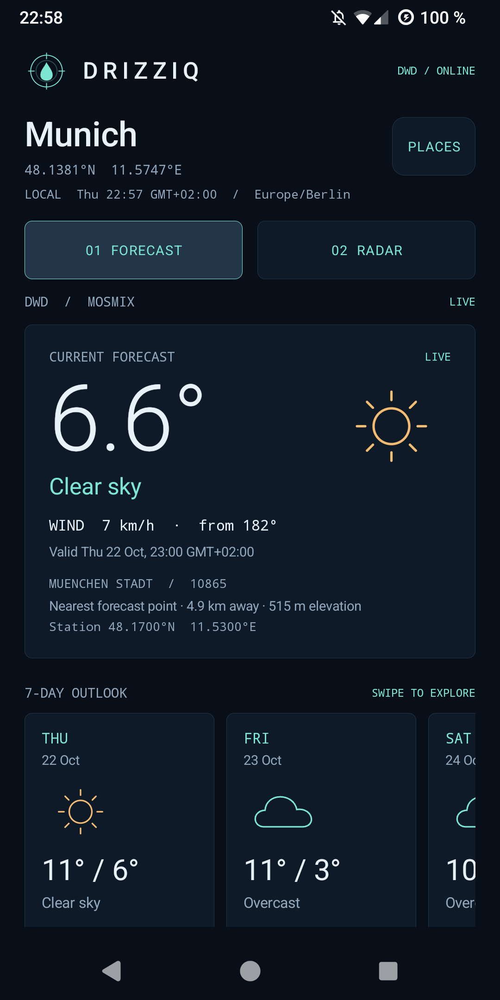

<h1 align="center">Drizziq</h1>

<p align="center">A dark atmospheric console for DWD weather forecasts and precipitation radar.</p>

<p align="center">
  <a href="https://codeberg.org/k4r/drizziq"></a>
  <a href="app/build.gradle.kts"></a>
  
  <a href="LICENSE"></a>
</p>

<p align="center">
  
</p>

Drizziq is a native Kotlin Android app for one selected place, specified in [SPEC.md](docs/SPEC.md). It reads weather directly from Deutscher Wetterdienst open data and runs on Android 7.0+ (API 24). No accounts, ads, analytics, tracking, or GPS permission.

## What it does

- **Forecast.** Current forecast temperature, condition, wind and validity; a seven-day outlook with hourly temperature ranges, maximum wind, precipitation and sunshine; up to 48 hours of hourly detail. The selected coordinates, nearest DWD forecast station, distance, station elevation, forecast validity and issue time are explicit.
- **Radar.** A freely pannable and zoomable map with a selected-place marker, recenter, pinch and button zoom, timeline scrubbing, a NOW marker, and looping playback. DWD RV supplies the preceding hour of observations and its available two-hour forecast, normally 37 frames. Each frame carries its actual DWD validity time. The legend shows millimetres per five minutes; hatching identifies missing radar data.
- **Places.** Enter any valid latitude and longitude. Munich is the initial location. Save labelled favourites, select them, and delete them; both favourites and the selection persist across restarts. Time zones are estimated offline and can be overridden.
- **Honest data states.** Loading, live, cached, stale and error are visible. Failed refreshes retain timestamped successful data. Missing DWD fields are omitted; relative humidity is normally absent from MOSMIX. Daily rain and sunshine totals require every hourly interval of a complete local day.

## Build and install

Requires JDK 21, Android SDK platform 37 and Build Tools 36.0.0. Open this directory in Android Studio, or set `ANDROID_HOME` to your SDK and run:

```sh
./tools/verify --gradle-only assembleDebug
adb install -r app/build/outputs/apk/debug/app-debug.apk
adb shell am start -n app.drizziq/.MainActivity
```

The wrapper pins Gradle 9.6.0 with a distribution checksum. Android Gradle Plugin 9.4.1 supplies Kotlin support. The only application library is jHDF 0.8.6, which reads DWD's current ODIM HDF5 radar format; Android core-library desugaring supports API 24.

Run the complete local development gate with:

```sh
./tools/verify
```

This checks Kotlin formatting, Python tooling tests, JVM unit tests, Android lint, and debug/release/device-test APK builds. No CI or phone is required. See [DEVELOPMENT.md](docs/DEVELOPMENT.md) for test-first development, focused checks, debug signing, and quick versus full phone verification. [AGENTS.md](AGENTS.md) defines the workflow for agents.

The default phone runner performs smoke checks. Use `--full` explicitly for integration checks that change test favourites and connectivity. Historical device results and screenshot provenance are in [VERIFICATION.md](docs/VERIFICATION.md).

## Data

Weather comes exclusively from `https://opendata.dwd.de/weather/`. MOSMIX is a station forecast: the app chooses the nearest published point and displays its distance. DWD radar covers Germany and its surroundings; places outside that coverage receive an explicit coverage message. The keyless OpenStreetMap basemap has visible attribution and caches only tiles viewed on screen for at least seven days.

All app icons and pictograms are drawn in this repository. [DATA.md](docs/DATA.md) records data sources, processing, licences and metadata regeneration.

## License

[MIT](LICENSE). DWD data, OpenStreetMap data, timezone data and dependencies retain their [respective licences](docs/DATA.md).
