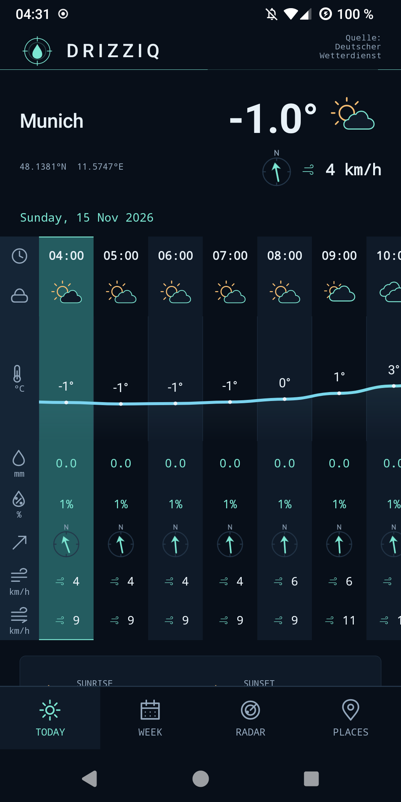
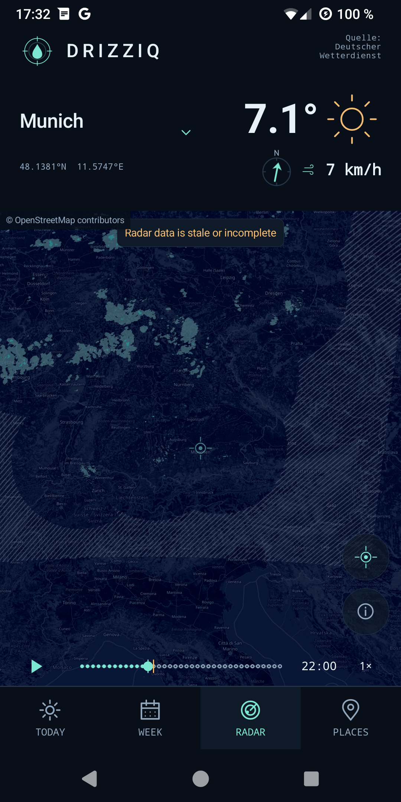

<h1 align="center">Drizziq</h1>

<p align="center">A dark weather console for one place. Forecasts and rain radar straight from the DWD — no account, no ads, no tracking.</p>

<p align="center">
  <a href="https://github.com/psyke089/drizziq"></a>
  <a href="app/build.gradle.kts"></a>
  
  <a href="LICENSE"></a>
</p>

<p align="center">
  
  
</p>

<p align="center"><sub>Debug builds on a OnePlus 5T. Weather © DWD, <a href="https://creativecommons.org/licenses/by/4.0/">CC BY 4.0</a> · Map © <a href="https://www.openstreetmap.org/copyright">OpenStreetMap contributors</a></sub></p>

Drizziq answers one question well: what is the weather doing at *my* place, now and in the next few hours? It is a native Kotlin app for Android 7.0+, with one dark HUD, no settings maze and no cloud account. Everything it shows comes from free public data, and the app handles the unglamorous parts itself — station selection, time zones, retries, caching, offline behaviour.

## What it does

- **Today.** Hourly forecast from local midnight through noon tomorrow, with colour-coded temperatures, precipitation, wind and gusts. Sun times are calculated on device and work offline.
- **Week.** Seven days at a glance: condition, high/low, rain, maximum wind and sunshine. Earlier and newer forecast issues are merged, with the latest values winning.
- **Radar.** Pan, zoom, scrub and play the rain radar. The newest image appears first, cached tiles show up instantly, and observations (`OBS`) are clearly separated from forecasts (`+35` min). Jump to now or slow the loop down; the timeline marks the boundary between observed and predicted rain.
- **Places.** Search a city, pick one, optionally use your current location once. Favourites keep their provenance and survive restarts.

## Small print worth knowing

- The app is a **station forecast**, not a smooth grid: it picks the nearest bundled DWD MOSMIX station within 50 km and shows the distance. Designed for Germany and its surroundings.
- **Honest freshness.** A stale or failed refresh never silently replaces good data; cached data is labelled and kept. Missing DWD fields stay missing — humidity, for example, is usually not supplied.
- **Location is optional** and used only for one explicit snapshot. Positions are resolved locally, without reverse geocoding.
- Radar polls every five minutes only while visible; forecasts refresh on a 30-minute rhythm. Both can be forced from the UI. Only the visible map is downloaded and revalidated conditionally.

## Build

Needs JDK 21, Android SDK platform 37 and Build Tools 36.0.0. Python 3.11+ runs the helper scripts; no third-party packages.

```sh
./tools/verify --gradle-only assembleDebug
adb install -r app/build/outputs/apk/debug/app-debug.apk
adb shell am start -n app.drizziq/.MainActivity
```

Or open the directory in Android Studio. The full local gate — formatting, Python tooling tests, JVM tests, lint and all three APK builds — is:

```sh
./tools/verify
```

[AGENTS.md](AGENTS.md) covers focused checks, signing, phone verification and releases. The default phone runner uses local fixtures and rejects unexpected network requests.

## Data

| Source | Used for | Licence |
|---|---|---|
| [DWD open data](https://opendata.dwd.de/weather/) | MOSMIX forecasts, radar archives | CC BY 4.0 |
| [OpenStreetMap](https://www.openstreetmap.org/copyright) | Radar basemap tiles | ODbL |
| [Open-Meteo geocoding](https://open-meteo.com/en/docs/geocoding-api) / [GeoNames](https://www.geonames.org/) | City search after a 400 ms pause | CC BY 4.0 |
| [tz-lookup](https://github.com/photostructure/tz-lookup) | Offline time-zone lookup | CC0 / ODbL |
| [jHDF](https://github.com/jamesmudd/jhdf) | Reading ODIM HDF5 radar frames | MIT |

All icon sources are editable SVGs in [artwork/icons](artwork/icons/README.md) and are compiled into Android vectors at build time. Full attribution and licence texts are bundled in the app and recorded in [AGENTS.md](AGENTS.md#data-sources-and-behavior).

## License

[MIT](LICENSE). Bundled data and dependencies keep their [respective licences](app/src/main/assets/notices.txt).
