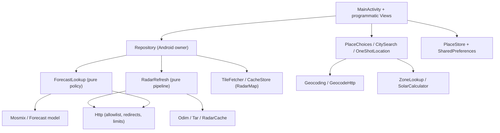

> Historical 1.6.4 report, superseded by the [validated review and 1.6.5 resolution record](2026-11-05-203902-ds41f-revised.md).

# Drizziq 1.6.4 — full code review

| | |
| --- | --- |
| Reviewed | 2026-11-05 20:39–20:58 local |
| Commit | `2af89b3` — Release 1.6.4 with incremental radar loading and progress controls |
| Version | `1.6.4` (`versionCode` 12) |
| Scope | 39 Kotlin files / 7,258 lines under `app/src/main`; 26 JVM test files (186 `@Test` methods); 2 instrumentation files; Python tooling and tests; Gradle/CI; assets and licences |
| Method | Full static read, targeted cross-checks against DWD and tz-lookup sources, dependency/licence reconciliation, and execution of the local verification gate. No phone/instrumentation run in this review. |

## Verdict

No critical defect, data-corruption path, hard-coded secret, cleartext endpoint or licence gap was found. The code is notably disciplined for a single-developer app: parsing and cache policy are kept out of the UI, security-sensitive input is bounded, time-zone handling is explicit, and the test suite is unusually strong.

The material weaknesses are operational and UI-state related:

1. The foreground tick refreshes **both** forecast and radar every five minutes, regardless of page or source freshness.
2. Keyboard “Search” cannot force a geocoding refresh while cached results exist, despite the UI promising a retry.
3. Timeline scrubbing can queue many duplicate full-size PNG decodes.
4. Week daily rain/sun totals ignore the earlier-issue hours that are already fetched for Today.
5. Offline/error copy claims data was retained when no data exists.
6. One corrupt radar frame invalidates the entire cached radar sequence, and the cache's `invalid` list is unused.

Everything else below is low-severity robustness, performance, dead-code or test-gap material.

## Verification performed

| Check | Result |
| --- | --- |
| `python3 -m unittest discover -s tools/tests -v` | 35 tests, `OK` |
| `./tools/verify --gradle-only testDebugUnitTest --rerun-tasks` | `BUILD SUCCESSFUL`; 27 tasks executed |
| `./tools/verify --gradle-only formatCheck lintDebug` | `BUILD SUCCESSFUL` |
| `./tools/verify --offline` (full local gate) | `BUILD SUCCESSFUL`; 133 tasks; Python tests, format, JVM tests, lint, debug/release/device-test APKs |
| Runtime dependency graph vs `notices.txt` | Matches: Kotlin 2.2.10, annotations 13.0, SLF4J 2.0.18, commons-lang3 3.20.0, compress-lzf 1.2.0, lz4-java 1.11.1, jHDF 0.13.0 |
| `gradle-wrapper.jar` SHA-256 | Matches `gradle/wrapper/NOTICE`: `3b8a2577…8e98` |
| Pinned `stations.tsv` SHA-256 | Matches `StationIndexTest`: `713df55d…7f3c` |
| DWD `SunD1` unit | Confirmed `s` in DWD `MetElementDefinition.xml`; `/ 3600` in `Day.sun` is correct |
| `ZoneLookup.at` vs pinned tz-lookup 11.7.0 | Quadtree index arithmetic matches the pinned upstream `tz.js` |
| Compiler warnings | Only deprecations and one `Any?` reflection warning; no errors. See N17. |

The checked-in Android tests were not run because that requires the usual device and install step. No conclusions below depend on device results.

## Architecture at a glance

The layering is clear and consistent with the repository rules:

Good separations:

- `ForecastLookup`, `RadarRefresh`, `SolarCalculator`, `StationIndex`, `CachePolicy`, `TileFetcher`, `CitySearch` and `OneShotLocation` are pure enough for deterministic JVM tests.
- Android ownership is unusually clean: one Activity, no ViewModel/coroutine/Flow layer, one Repository, generation tokens and explicit main-thread posting.
- `MainActivity` owns view state; the Repository never touches views. `Repository` emits immutable `Reading` values and generation-gated callbacks.
- Cache access recency, HTTP receipt freshness and app data freshness are correctly kept as three separate concepts.

## Findings

### Summary

| ID | Severity | Area | Finding |
| --- | --- | --- | --- |
| R1 | High | Automatic refresh | Five-minute tick re-fetches forecast and radar regardless of page or freshness |
| R2 | Medium | City search | Keyboard retry cannot bypass a warm cache; UI copy promises retry |
| R3 | Medium | Radar UI | Scrubbing enqueues duplicate full-size PNG decodes; no coalescing or cancellation |
| R4 | Medium | Week totals | Daily rain/sun ignore the earlier-issue hours already used by Today |
| R5 | Medium | Offline copy | “Last … retained” messages are emitted with no retained payload |
| R6 | Medium | Radar cache | `RadarCacheRead.invalid` is ignored; one bad frame discards the whole sequence |
| R7 | Low | Threading | `RadarMap.online` is read by tile workers without `@Volatile` |
| R8 | Low | State | A refresh can briefly downgrade an in-memory LIVE forecast to CACHED |
| R9 | Low | Startup I/O | PNG validation reads every radar file completely before first display |
| R10 | Low | Lifecycle | Hourly highlight timer keeps running while the Activity is stopped |
| R11 | Low | Semantics | `Forecast.current()` can select a future hour as “current” |
| R12 | Low | Cache robustness | Radar manifest time/lead/grid fields are not cross-validated |
| R13 | Low | Offline radar | Loading a cached radar sequence while offline still starts a refresh attempt |
| R14 | Low | Maintenance | Unused layers art, test-only `RadarCache.reusable`, unused HTTP Range support |
| R15 | Nit | Favourites | `save` identifies by coordinates, `delete` by full value equality |
| R16 | Nit | Tests | Missing focused tests for R1–R5 and `ZoneLookup` |
| R17 | Nit | Warnings | Deprecated Android APIs and one reflection type warning |

### R1 — Foreground polling ignores source cadence and the visible page

**Evidence**

- `MainActivity.kt:137-144` schedules the tick every 30 s and calls `refresh()` whenever `now - lastRefresh > 300000`.
- `MainActivity.kt:935-940` `refresh()` unconditionally calls `repo.connection()`, `repo.refreshForecast()` and `repo.refreshRadar()`.
- `Repository.kt:372-375` `refreshForecast()` only checks `forecast.refreshing`; `select()` then re-runs the full load.
- `ForecastLookup.kt:101-103` always calls `source.fetch()` when online. There is no “issue is still fresh” or “same issue already downloaded” short circuit.
- `ReadingPolicy.kt:1-2`: forecast freshness is 9 hours from issue; radar freshness is 20 minutes.

**Impact**

- Forecast MOSMIX issues arrive every six hours, but the app re-downloads and re-parses the latest KMZ every five minutes while foregrounded. The same 5-minute clock also refreshes radar even when Today/Week/Places is visible and radar has never been viewed.
- This produces avoidable DWD traffic, repeated cache parsing, repeated `Reading` updates, repeated forecast-view rebuilds and unnecessary battery/CPU use. The radar request is conditional, so a 304 may avoid the body, but forecast has no conditional request or issue gate.
- It also makes automatic freshness and manual refresh indistinguishable.

**Recommendation**

Split refresh intent: `refresh(force: Boolean)`. Automatic ticks should:

- refresh radar only when the radar page is visible or the radar issue is older than a useful interval;
- refresh forecast only when the issue is stale, missing, or older than a modest wall-clock window;
- let manual REFRESH and network recovery force a fetch.

An even cheaper forecast path is a conditional GET against `MOSMIX_L_LATEST` if the DWD endpoint supplies validators; otherwise gate on `Reading.fetched`/issue age.

### R2 — Keyboard Search does not force a geocoding request

**Evidence**

- `PlaceChoices.kt:159-185` always calls `search.search(query, false, connected, …)`.
- `SearchDebounce.kt:33-37` routes the keyboard action through `immediate()`; `immediate()` still calls the same `submit()` with no force flag.
- `Geocoding.kt:227`: `if (cached != null && !refresh) return SearchResult.Results(cached, true)`.
- `app/src/main/res/values/geocoding.xml` says “use keyboard Search to retry”, and `city_search_hint` is shown in the dialog.

**Impact**

Scenario: a query has cached results; a subsequent network refresh fails before the 30-minute cache TTL expires. The dialog shows “Cached results · search unavailable”. The user presses keyboard Search as instructed; the worker immediately returns the cached result, performs no request, and the same failure/results are shown until the cache expires or the user clears the cache from Places. The explicit retry path is therefore not a retry when cache is warm.

**Recommendation**

Add a `force: Boolean` to the submit path and pass `refresh = force` to `CitySearch.search`. Debounced typing should use `force = false`; IME Search should use `force = true`. Add a `CitySearch`/`PlaceChoices` regression test that warms the cache, forces a failure, presses retry, and asserts one transport call.

### R3 — Timeline scrubbing queues duplicate full-size decodes

**Evidence**

- `RadarTimeline.kt:462-471` calls `onSelect` for every `ACTION_DOWN`, `ACTION_MOVE` and `ACTION_UP`.
- `MainActivity.kt:651-654` maps `onSelect` directly to `requestFrame`.
- `MainActivity.kt:825-875` increments `decodeToken` and, unless the bitmap is already in the 3-entry `LruCache`, unconditionally submits `BitmapFactory.decodeFile` to a single-thread executor. There is no `frame.file == requestedFrameFile` early return, no pending-request coalescing and no cancellation of already queued decodes.

**Impact**

Dragging across the timeline at touch-event rate can enqueue dozens of decodes of 1100 × 1200 PNGs. Every queued task still performs the full disk read and bitmap decode; only *after* decoding does it discover that its token is stale and recycle the bitmap. That delays the frame the user actually wants, burns CPU, and can create noticeable scrub jank and allocation churn on the target phone.

**Recommendation**

Use latest-wins coalescing:

- return immediately if `frame.file == requestedFrameFile` and a decode is already pending;
- keep exactly one pending decode (single-slot queue or a `Future` that is cancelled/replaced), or maintain a generation check before starting the decode as well as after it;
- optionally set the timeline's selected index immediately and keep the map's last decoded bitmap until the requested frame arrives.

This is a good candidate for a focused instrumentation test that performs a rapid full-width drag and asserts queued work does not grow with touch-move count.

### R4 — Week daily totals ignore earlier-issue history

**Evidence**

- `Weather.kt:207-225` `Forecast.days()` groups only `hours`; `Forecast.earlier` is not included.
- `ForecastPresentation.kt:16,24` `hourlyColumns()` explicitly merges `forecast.earlier + forecast.hours` for Today.
- `ForecastLookup.kt:70-76` fetches the preceding MOSMIX issue specifically to fill hours from local midnight.

**Impact**

With a fresh issue that starts after local midnight, Today's hourly table can be complete from midnight (via `earlier`), while Week's first row still marks today's rain and sunshine unavailable because `Day.complete` is false. On the fixture, the 15:00 UTC issue starts at 16:00 UTC; a Munich day beginning at 22:00 UTC on the previous date cannot be complete from `hours` alone, even though the preceding issue was fetched. This is an internal inconsistency between the two screens and a likely product bug; it may also affect the following day around midnight.

**Recommendation**

Confirm the intended rule. If earlier-issue hours are valid forecast evidence for aggregates, merge `earlier + hours` (latest wins for duplicate times, same as `hourlyColumns`) before grouping days, and add a test proving a complete day from the preceding issue yields rain/sun totals. If only the latest issue may contribute, document that explicitly in `AGENTS.md`/README and keep the “—” behavior.

### R5 — Offline messages claim retained data when nothing was retained

**Evidence**

- `Repository.kt:256-261` always writes “Offline · last successful data retained” and “Offline · last successful frames retained”, regardless of `forecast.data`/`radar.data`.
- `ForecastLookup.kt:97-99` emits `retained.failed("Offline · last matching forecast retained")`, where `retained` is a default empty `Reading()` on a first run with no cache.
- `ReadingPolicy.kt:26-31` maps `failed()` on null data to `Freshness.ERROR`, preserving the message.
- `MainActivity.kt:373-389` displays `data.message` under “No forecast received” when the state is `ERROR`.

**Impact**

A first launch with no network and no cache shows “No forecast received” followed by “Offline · last matching forecast retained” / “Offline · last successful data retained”. That is factually contradictory and undermines the app's explicit honest-state design. The radar equivalent is less visible because the notice prioritizes “Radar unavailable”/“Offline radar”, but the same message is stored.

**Recommendation**

Choose wording based on `data != null`:

- no data: “Offline · no saved forecast” / “Offline · no saved radar”;
- data present: “Offline · showing last saved forecast” / “… radar”.

Add a `ForecastLookup` test for offline + empty previous + no cache, and a `Repository`/phone check for first-launch offline.

### R6 — Corrupt radar cache handling discards valid frames and ignores `invalid`

**Evidence**

- `RadarCache.kt:140-143` documents that a null sequence names files “that should be removed before the next refresh regenerates”.
- `RadarCache.kt:158-203` accumulates `invalid`, but the entire `runCatching` sequence construction returns `null` on the first bad frame; valid frames are not returned.
- `Repository.kt:385` and `Repository.kt:419` call `RadarCache.read(directory).snapshot` and discard `RadarCacheRead.invalid`.

**Impact**

One missing/corrupt/wrong-size PNG makes the whole cached sequence invisible: `RadarRefresh` receives no cached snapshot and cannot reuse any of the other valid frames, so it re-downloads and re-decodes all of them. The bad file is not deleted either. On a persistent decode/cache failure or while offline, stale radar files remain until a later successful refresh's one-hour cleanup or an explicit clear. This contradicts the cache contract and weakens cache resilience.

**Recommendation**

After `RadarCache.read`, on the radar worker, delete `read.invalid` files that are not referenced by the returned sequence. Consider returning/using the valid subset (or having `RadarRefresh` treat invalid entries as reusable misses) so one bad frame does not invalidate the whole timeline. Add a test that a single corrupt frame leaves the other frames reusable and removes the bad file before the next refresh.

### R7 — `RadarMap.online` is read by worker threads without visibility guarantee

**Evidence**

- `RadarMap.kt:88` declares `var online = true`.
- `MainActivity.kt` sets it on the main thread from `renderRadar()`; `RadarMap.kt:303-317` reads it inside `executor.execute { tileFetcher.load(..., online) }`.

**Impact**

The boolean write is atomic, but there is no happens-before edge. A tile worker can observe a stale `true` after connectivity loss (attempting an unwanted request) or a stale `false` after recovery (displaying cached tiles instead of fetching). The window is small, but this is exactly the kind of state that should be `@Volatile`.

**Recommendation**

Mark `online` `@Volatile` (or pass the current value into the worker as a captured immutable argument, which also makes the request decision deterministic).

### R8 — Refresh can downgrade LIVE to CACHED and reparse disk

**Evidence**

- `ForecastLookup.kt:82-94`: if the on-disk cache has an issue >= the in-memory retained issue, it replaces `retained` with a `CACHED` `Reading` and emits it before the network fetch. Equal issues satisfy `>=`.
- `Repository.kt:332-346` retains the previous `Reading` for a same-place refresh.

**Impact**

A manual or automatic refresh of the same issue first shows the saved-file state and its file timestamp, even though the in-memory reading is already LIVE. The UI rebuilds and the details card can briefly show CACHED / an older “Last updated” value. The cached KMZ is also parsed again on every refresh.

**Recommendation**

Only emit the disk cache when it is strictly newer than the retained reading, or when no retained data exists. If the previous reading is LIVE/refreshing for the same issue, keep it and show “Checking DWD” without the CACHED emission. This also avoids the extra parse.

### R9 — PNG validation reads and CRC-checks whole radar files on startup

**Evidence**

- `RadarCache.kt:25-27` `Png.dimensions(file)` calls `file.readBytes()` and then `Png.dimensions(bytes)`, which walks every chunk and verifies CRCs.
- `RadarCache.read()` does this for every manifest frame before returning a sequence.
- `MainActivity` displays radar only after `Repository.loadRadarCache()` completes.

**Impact**

A valid cached radar sequence with 25 frames reads and CRCs the entire PNG set before the first frame can be shown. Files are small (the checked-in 1100 × 1200 fixture is ~4 KB compressed), so this is not severe, but it is avoidable startup I/O and CPU on a phone. It also means one corrupt file blocks first display of all valid files (R6).

**Recommendation**

Stream only the IHDR/chunk headers needed for dimensions, or store dimensions/CRC validity in the manifest and validate lazily when a frame is first decoded. Retain full validation where it matters (before reuse/after download).

### R10 — Hourly highlight timer keeps running while the Activity is stopped

**Evidence**

- `HourlyForecast.kt:44-50` posts the highlight tick every minute; `onAttachedToWindow` starts it and `onDetachedFromWindow` stops it (lines 250-258).
- `MainActivity.onStop` (line 1155) cancels solar work and other work but the view remains attached, so the hourly timer continues while the Activity is stopped.

**Impact**

A minute-resolution callback and a view invalidate continue in the background for a hidden screen. No network or wake lock is involved, so this is low severity, but it is unnecessary work and violates the “stopped window should be quiet” intent used elsewhere (network and solar work are stopped).

**Recommendation**

Stop/start the tick from `onWindowVisibilityChanged` or explicit Activity lifecycle calls, or move the tick to a central Activity tick that is already cancelled on pause.

### R11 — `Forecast.current()` can select a future hour

**Evidence**

- `Weather.kt:204-205`: `hours.minByOrNull { abs(it.time - now) }?.takeIf { abs(...) <= 3600000 }`.

**Impact**

At 00:10 local with the first available hour at 01:00 (for example, without earlier history), the header labels the 01:00 forecast as current. The same ±1-hour nearest rule also appears in the details card. This is a semantic edge, not a crash: it can show a forecast valid up to 59 minutes in the future as “current”.

**Recommendation**

Decide whether “current” means the containing hour or the nearest hour. If containing, prefer the last hour <= now and only fall back to the next hour when no prior value exists; alternatively expose “next hour” explicitly. Add a boundary test at 00:10 with first hour 01:00.

### R12 — Radar manifest fields are not cross-validated

**Evidence**

- `RadarCache.kt:163-194` reads `time`, `issue`, `lead`, `w`, `h`, `left`, `top`, `dx`, `dy` and only checks PNG dimensions against `w`/`h`.
- It does not require `time == issue + lead * 60_000`, `lead in 0..120`, `lead % 5 == 0`, finite/positive grid values, or at least one observed and one forecast frame.

**Impact**

The manifest is app-private, so this is not a remote attack surface. A partially corrupted or old-format manifest can nevertheless produce a `RadarSequence` whose timeline/playback semantics are nonsense, and `MainActivity.renderRadar()` assumes a non-empty frame list and valid ordering. `RadarRefresh` later cross-checks some of this only on a 304 path.

**Recommendation**

Validate the manifest schema as a unit: safe names, non-empty frames, unique `(issue, lead)`, time relation, bounded lead, finite positive grid, and required observed/forecast entries. Reject the whole manifest or the bad entries consistently.

### R13 — Cached radar load attempts a refresh while offline

**Evidence**

- `Repository.kt:381-398` `loadRadarCache()` always calls `refreshRadar()` after publishing cached data.
- `Repository.kt:403-417` sets `radarProgress = DOWNLOAD`, sets `refreshing = true`, and only then checks `online`, which throws and is caught as a refresh failure.

**Impact**

On startup while offline with cached radar, the app briefly shows “Saved radar · checking DWD”, then enters `RadarPhase.FAILED` with “Refresh failed · Offline”. No HTTP request is issued (the `check(online)` is before the request), so the data policy is safe, but the state/progress UI is misleading and wasted work is performed.

**Recommendation**

In `loadRadarCache`, if `online` is false, publish the stale cached sequence and stop; leave progress `IDLE` and let the existing offline notice explain the state. Refresh only on an explicit user action or connectivity return.

### R14 — Dead assets and dead production code

**Evidence**

- `artwork/icons/ui/layers.svg` has no runtime reference; `IconAssets.kt:12` still maps `"layers"` to `R.drawable.ic_layers`, so the generated drawable ships unused.
- `RadarCache.reusable()` (`RadarCache.kt:232-234`) is referenced only by `RadarCacheTest`; production reuse is implemented directly in `RadarRefresh` from the cached sequence.
- `Http.bytes(address, limit, range)` and `Http.read(..., range, ...)` (`Repository.kt:29-31`, `98-99`, `152-190`) support partial reads, but no production caller passes a non-null range.

**Impact**

Small APK/asset and maintenance weight. The Range code also has brittle parsing (`substringAfter('-').toInt()` assumes both ends), so keeping an unused, untested feature increases the surface for future confusion.

**Recommendation**

Remove the layers SVG/generated resource and regenerate, or use it if a layer control is planned. Either use `RadarCache.reusable` in the production reuse path or remove it and its tests. Remove Range support unless a concrete caller needs it; if retained, test both bounded and malformed ranges.

### R15 — Favourite identity differs between save and delete

**Evidence**

- `PlaceStore.kt:76-78` `save` deduplicates by latitude/longitude.
- `PlaceStore.kt:80-87` `delete` removes by full `Place` equality (label, zone, geocode id, provenance flag).

**Impact**

The current UI passes the object read from `favourites()`, so the common path works. However, a stale card or a caller that reconstructs the same location with a different label/zone can report a successful delete while the stored favourite remains. The asymmetry with `save` is a maintenance trap.

**Recommendation**

Use the same coordinate identity for delete (or an explicit stable favourite key) and add a test for a same-coordinate/different-label delete.

### R16 — Test gaps aligned with the findings

The existing suite is strong on pure behavior and failure retention. The following are not covered by a focused test today:

- automatic tick refresh cadence/page awareness (R1);
- keyboard Search forcing a request over a warm cache (R2);
- rapid timeline scrubbing / decode coalescing (R3);
- `Forecast.days` with `earlier` populated (R4);
- first-launch offline with no cache and no retained data (R5);
- radar cache `invalid` cleanup/partial reuse (R6);
- `ZoneLookup.at` against a small set of known coordinates;
- radar manifest cross-field validation (R12).

The phone suite covers the visual and lifecycle paths well; these are mostly repository/policy gaps that can be unit-tested without a device.

### R17 — Compiler warnings / deprecated APIs

The re-run produced only warnings, not failures:

- deprecated `resources.displayMetrics.scaledDensity` in `CurrentWeatherHeader` and `MainActivity`;
- deprecated `Window.setDecorFitsSystemWindows` / `systemUiVisibility` / `systemWindowInset*` paths for API < 30;
- deprecated `onBackPressed` (legacy path by design);
- deprecated `AccessibilityNodeInfo.RangeInfo.obtain`;
- `RadarData.kt:225` reflection type warning (`JArray.get` returns `Any?`).

None are functional regressions today, but the Gradle log also reports deprecated Gradle features that will become incompatible with Gradle 10. Plan a small compatibility pass before the next toolchain upgrade.

## What is done well

### Data/parsing and time

- Strict MOSMIX parsing with an explicit field whitelist, ordered timestamps, value-count limits and decompressed-size budgets.
- XXE/DOCTYPE rejection has both parser features and a byte-state `MarkupGuardStream` fallback for platform parsers that cannot disable DTDs.
- Unit conversions are correct and centralized: Kelvin, m/s → km/h, Pa → hPa, `R101`, `FX1`, `SunD1` seconds.
- Missing values remain missing; no humidity derivation from temperature/dewpoint; no interpolated daily totals.
- DST, skipped days, repeated hours, fractional-offset zones and "local midnight through tomorrow noon" semantics have unusually good tests.
- `Forecast.days`' interval-ending date convention (`time - 1`) is consistent with DWD's "preceding hour" semantics and is covered by 23/25-hour-day tests.
- The tz-lookup port matches the pinned quadtree implementation; the station catalogue is hash-pinned.

### Radar

- Projection parameters are validated against the recorded DE1200 definition rather than assumed.
- ODIM decoding validates quantity, dimensions, interval, grid and missing/dry values; historical gaps are explicit.
- Radar refresh is incremental and publishes frames as they become ready, with cached-PNG reuse, conditional latest requests, bounded history requests and a preserved successful-download timestamp on 304.
- The map uses projected geographic meshes rather than drawing radar pixels as a plain rectangular image, and it keeps a single playback loop.
- Cache validation is versioned (manifest + palette) and PNG chunks are structurally checked.

### Networking and storage

- HTTPS allowlist with per-hop redirect validation and bounded redirect counts.
- Response size limits, ZIP entry/decompressed budgets, tar member limits and 5-minute radar interval checks.
- Atomic same-directory writes with unique temp files and fsync; failed writes retain previous data.
- Separate access-recency and HTTP-receipt indices; conditional tile revalidation after seven days; visible-tile-only requests.
- Offline/failed refresh retention is deliberate and covered by tests/phone phases.
- OSM attribution is visible and linked; DWD source is credited in the header and notices.

### UI/accessibility and lifecycle

- Programmatic views avoid XML/resource duplication and keep the HUD palette in one place.
- Weather glyphs rotate/position vector drawings rather than drawing icon shapes in Canvas.
- The hourly row alignment, temperature ribbon gap handling and missing-value text are explicit.
- Radar has content descriptions, SeekBar semantics, custom zoom/recenter actions and a descriptions panel with separate download/image/history progress.
- Dialog dismissal, pending work invalidation, Activity recreation, notices-window cleanup and stopped-network behavior are exercised by the phone exercise.
- No logging of search text, coordinates or full URLs.

### Engineering process

- 186 JVM tests, 35 Python tests and 28 instrumentation phase labels; fakes and fixed clocks are used consistently.
- `formatCheck`, `lintDebug` with `warningsAsErrors`, debug/release/device-test builds all pass.
- Dependency notices match the actual runtime graph; wrapper/asset hashes are pinned.
- SVG icon generation is deterministic, supports inherited styles/transforms/opacity, fails on unsupported features and has a `--check` mode.
- Metadata regeneration validates the full DWD catalogue and timezone source before atomically replacing bundled assets.

## Data, licence and privacy review

| Area | Assessment |
| --- | --- |
| DWD | Open data, CC BY 4.0; source credited in header/notices; `<ShName>SunD1` unit confirmed as seconds. |
| OSM tiles | HTTPS-only host, visible copyright link, identifying User-Agent (`Drizziq/<version>`), conditional revalidation, 7-day freshness, 64 MB budget, visible tiles only. |
| Open-Meteo/GeoNames | Keyless endpoint, count/language/format as documented, explicit selection, no country filter, no persisted search history/logging, Retry-After honoured, attribution retained in search and notices. |
| Location | Optional foreground coarse/fine, one snapshot, local station/zone resolution, no reverse geocoding, no background service. |
| Time zones | Pinned tz-lookup 11.7.0/CC0 + timezone-boundary-builder/ODbL; source and licences included. |
| jHDF/desugaring | Versions match notices; jHDF MIT, its dependencies MIT/Apache, desugar GPLv2 + Classpath Exception with source link. |
| Backup | `allowBackup=false` and explicit cloud/device-transfer exclusions for all domains. |
| Cleartext/secrets | `usesCleartextTraffic=false`; no API keys/passwords in the repository; release signing key is CI secret only. |
| Logging | No app logging of queries, positions or URLs; the phone runner also avoids dumping coordinates/queries. |

One low-priority attribution consideration: the Open-Meteo/GeoNames credit is shown in the search dialog and notices, but saved favourite cards do not show `placeCreditView(place)`. Provenance is retained in `geocodeId`/`geocodeLabelEdited` and the notices text is reachable, so this is not a clear licence breach; showing the credit on a favourite's detail could make attribution more proximate.

## Build and tooling review

- `./tools/verify --offline` passes end to end: Python tests → formatCheck → JVM tests → lint → debug/release/device-test APKs.
- `build.gradle.kts` uses AGP 9.4.1, compileSdk 37, minSdk 24, Java 11 bytecode, core-library desugaring and `warningsAsErrors`.
- `formatCheck` includes all Kotlin/Gradle sources; generated `IconAssets.kt` is also covered.
- Build-time icon generation writes only changed outputs, removes generated files whose sources disappeared, and is checked by Python tests.
- CI restores the published signing key into `ANDROID_USER_HOME`, enforces tag/version equality, verifies the certificate SHA-256 and versionName, publishes SHA-256 alongside the APK, and uploads previews for `workflow_dispatch`.
- The Gradle wrapper JAR hash matches the checked-in NOTICE.
- The dependency graph matches the notices exactly (Kotlin/annotations/SLF4J/commons-lang3/compress-lzf/lz4/jHDF).
- The only notable future-work item is the Gradle 10 deprecation warning; no current build failure.

## Suggested order of work

1. **R1**: split automatic and manual refresh; make the tick page/freshness aware.
2. **R2**: make IME Search force a geocoding refresh; add the retry-over-cache test.
3. **R3**: coalesce radar frame decodes and cancel/ignore queued work before decode.
4. **R4/R5**: decide the daily-total source rule; fix offline empty-state wording.
5. **R6/R12**: delete/repair invalid radar cache entries; validate the manifest as a unit.
6. **R7/R13**: mark `RadarMap.online` volatile; avoid a refresh attempt when loading cached radar offline.
7. **R8–R11, R14–R17**: opportunistic cleanups and focused tests.

## Bottom line

This is a well-structured, test-heavy hobby app with strong data-integrity instincts. The highest-value next change is to make refresh intent explicit and freshness-driven: the app currently performs work that neither the visible screen nor the source cadence requires. After that, the city-search retry and radar-decode-coalescing fixes are the most user-visible improvements.
